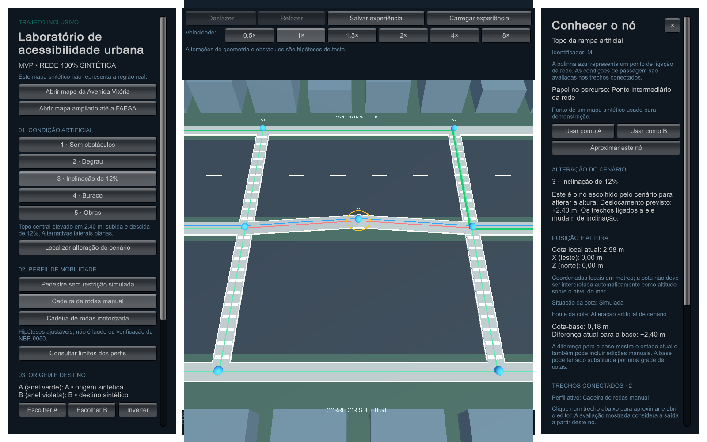
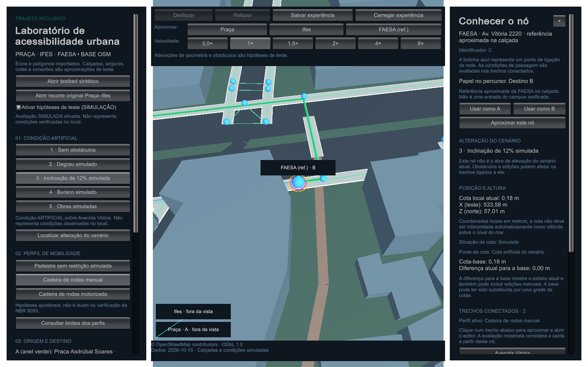

# Conheça os nós do simulador

Guia da versão 0.3.0, complemento do [manual de uso](MANUAL_DE_USO.md). A função está disponível nos executáveis Windows e Linux e nas três cenas.

## Clique numa bolinha azul

Cada bolinha representa um nó, um ponto de ligação da rede. Com nenhum comando de escolha de A/B ativo, clique na bolinha para abrir **Conhecer o nó**, no painel direito. Um **anel amarelo** destaca o ponto selecionado. Consultar o nó não modifica a geometria, o perfil, a origem, o destino ou as rotas calculadas.

Captura do executável Windows 0.3.0. O cenário eleva o topo da rampa e o painel identifica o ponto M e sua diferença de +2,40 m para a base.

O painel mostra:

- **Nome e identificador:** a referência que aquele ponto representa, como junção, topo de rampa ou referência aproximada da FAESA. O identificador permite distinguir pontos com o mesmo nome de rua.
- **Papel no percurso:** origem A, destino B, ambos ou ponto intermediário. A/B são papéis escolhidos para a experiência; o identificador do nó permanece fixo.
- **Alteração do cenário:** informa se este é o nó configurado para receber a mudança de altura e qual deslocamento o cenário prevê.
- **Posição e altura:** cota atual Y, coordenadas locais X e Z, situação e fonte da cota, cota-base e diferença atual para essa base. As coordenadas estão em metros locais; Y não é automaticamente uma altitude sobre o nível do mar.
- **Trechos conectados:** nome e identificador de cada ligação, ponto do outro lado, comprimento, faixa livre, inclinação de saída e avaliação para o perfil ativo. Clique no trecho para aproximá-lo e abrir seu editor.

O anel amarelo identifica a seleção; a avaliação de acessibilidade continua nas cores dos trechos. O nó não recebe uma classificação única de acessibilidade, pois cada ligação e sentido podem ter condições diferentes.

## Entenda os botões

| Ação | Resultado |
| --- | --- |
| Usar como A | Define o nó inspecionado como origem e recalcula os caminhos |
| Usar como B | Define o nó inspecionado como destino e recalcula os caminhos |
| Aproximar este nó | Enquadra o ponto e encerra o acompanhamento em andamento |
| Nome de um trecho conectado | Abre o editor do trecho e aproxima a ligação |
| Voltar à comparação ou × | Fecha a inspeção e remove o destaque |
| Esc | Cancela a escolha de A/B e fecha a inspeção |

Os botões **Escolher A** e **Escolher B**, no painel esquerdo, continuam disponíveis. Quando um deles está ativo, clicar numa bolinha escolhe o ponto para esse papel, em vez de abrir a inspeção. Os rótulos Praça, Ifes e FAESA no mapa abrem o nó correspondente e aproximam o ponto; os botões **Aproximar** da barra superior continuam servindo para navegar.

## Localize o que o cenário altera

Abaixo da descrição da **Condição artificial**, use **Localizar alteração do cenário**. O botão aparece quando o cenário referencia um elemento existente:

- Havendo obstáculo configurado, aproxima o primeiro trecho correspondente e abre o editor. Degrau, buraco e obras são alterações de trecho.
- Sem obstáculo e com deslocamento de altura, aproxima o nó elevado e abre **Conhecer o nó**.
- Sem essas alterações, o botão não aparece. No testbed sintético, até o cenário sem obstáculos mantém uma rampa suave no nó M.

No cenário de rampa, o nó é **M** no testbed e **GeoRamp** nos mapas geográficos. O painel distingue o deslocamento previsto pelo cenário da diferença atual para a base: edições manuais podem mudar a altura depois de o cenário ser aplicado. Uma grade de cotas pode substituir a base. A inspeção acompanha o estado atual ao trocar cenários, editar, desfazer, refazer ou carregar uma experiência.

O ponto de elevação dos mapas geográficos também ganha uma bolinha azul de seleção. O mapa usa marcadores nas junções e referências principais; pontos internos de divisão da rede podem não ter uma bolinha visível.

Captura do executável Windows 0.3.0. O ponto C representa a referência aproximada da FAESA e está definido como destino B nesta experiência. **© OpenStreetMap contributors — ODbL 1.0.**

## Demonstração para a apresentação

1. Abra o **testbed sintético**, selecione **Cadeira de rodas manual** e escolha **3 · Inclinação de 12%**.
2. Clique em **Localizar alteração do cenário**. O ponto **M** aparece destacado e o painel explica sua função como topo da rampa artificial.
3. Mostre a cota atual, a base e o deslocamento previsto de **+2,40 m**. Os dois trechos ligados ao topo ficam inclinados.
4. Role até **Trechos conectados** e abra uma ligação para explicar sua inclinação e a avaliação do perfil.
5. Escolha o cenário de degrau e use novamente **Localizar alteração do cenário**. Agora abre o trecho com o obstáculo, mostrando que nem toda alteração acontece na altura de uma bolinha.
6. Retorne à comparação. Clique em outro nó e use **Usar como A** para demonstrar que inspecionar e mudar o percurso são ações distintas.

Fala sugerida: “A bolinha identifica um ponto da rede. Ao clicar, vejo qual ponto é, sua altura e as ligações ao redor. A acessibilidade é avaliada em cada ligação. Este cenário eleva o ponto M e, por isso, muda a inclinação das duas calçadas que chegam a ele.”

O mapa geográfico preserva a distinção entre referência cartográfica e condições artificiais. A inspeção de um nó não verifica as condições do lugar nem ativa a avaliação simulada automaticamente. **© OpenStreetMap contributors — ODbL 1.0.**
