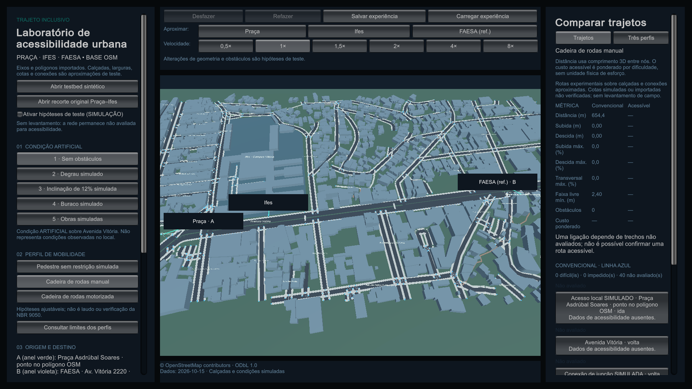

# Janela e enquadramento

A versão **0.3.1** corrige a faixa do mapa que aparecia acima da barra superior e libera o redimensionamento da janela do aplicativo.

## Aumente a janela

No Windows, use o botão **Maximizar**, ao lado do botão de fechar, ou arraste as bordas da janela. Use **Restaurar** para voltar ao tamanho anterior. A nova configuração se aplica ao executável; abra a versão 0.3.1 para receber a correção.

No Linux, o tamanho pode ser alterado pelas bordas e pelos comandos de maximizar do gerenciador de janelas. A disposição dos botões depende do ambiente utilizado.

Mantenha todos os arquivos do pacote juntos. Para atualizar, extraia o ZIP ou tar.gz da nova versão em uma pasta própria e execute o programa dessa pasta.

## Entenda a área do mapa

O mapa agora é desenhado somente na área entre os painéis laterais, abaixo da barra superior e acima dos créditos. Essa área muda junto com a janela. As margens ficam preenchidas, evitando fragmentos de imagem antigos após uma mudança de tamanho.

Captura do executável Windows 0.3.1, após alterar o tamanho da janela para 1920×1080. **© OpenStreetMap contributors — ODbL 1.0.**

Os rótulos de Praça, Ifes e FAESA continuam apontando para os pontos correspondentes. Os cliques na área do mapa usam o viewport atualizado; as margens fora dele não selecionam geometria que não está visível.

Mudar o tamanho da janela preserva cenário, perfil, origem, destino e os dados da experiência. Use **Enquadrar** ou **Focar percurso disponível** quando quiser ajustar a vista da câmera. Os painéis têm rolagem para consultar conteúdo que não caiba na altura disponível.

## Para apresentar

1. Abra a versão 0.3.1 e maximize a janela.
2. Escolha a cena e a experiência que vai demonstrar.
3. Use **Focar percurso disponível** e confirme que o texto está legível no projetor.
4. Ao voltar a uma janela menor, confira a rolagem dos painéis e ajuste o enquadramento, se necessário.

A mudança é de janela e apresentação do mapa. Os resultados das rotas continuam sendo os calculados pelo modelo para os dados e o perfil selecionados.
