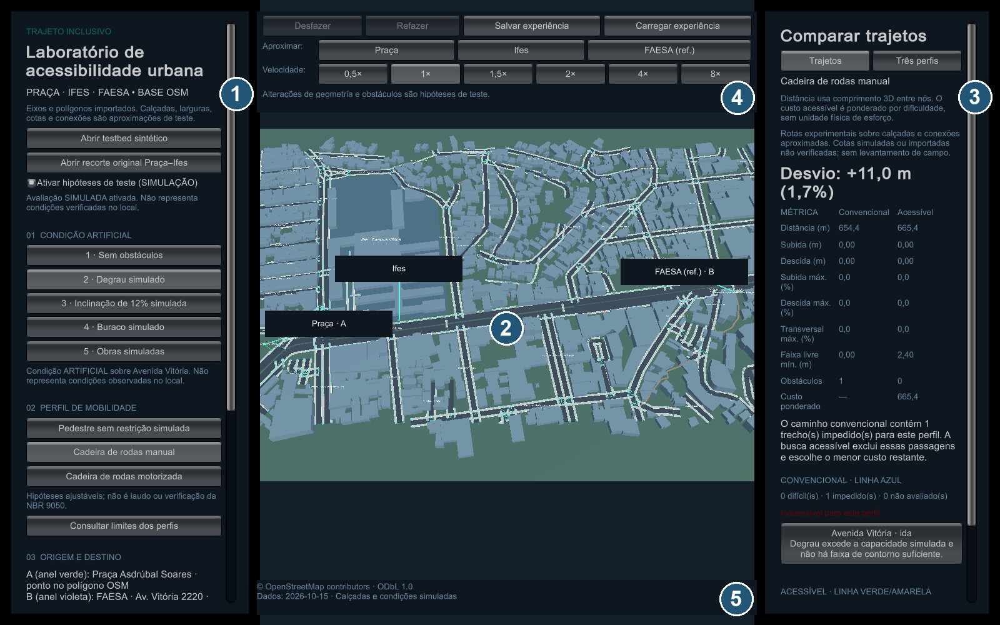
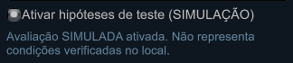
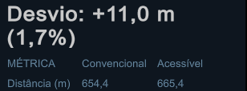
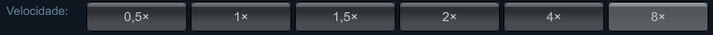
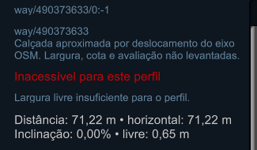
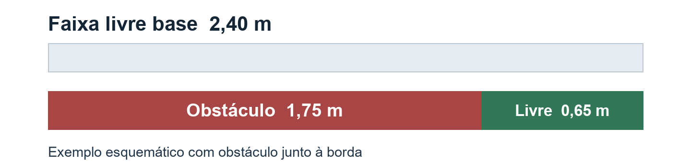
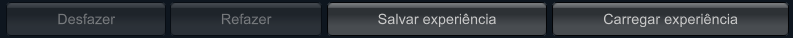

# Manual de uso do Trajeto Inclusivo

Guia didático para demonstração e apresentação

Versão do simulador 0.2.0 | 28 de outubro de 2026

**Complemento para a versão 0.3.0:** agora é possível clicar numa bolinha azul para conhecer o nó e usar **Localizar alteração do cenário**. Consulte o [guia de inspeção de nós](INSPECAO_DE_NOS.md). O PDF e o Word da versão 0.2.0 mantêm a paginação original; este guia documenta a função adicionada depois da elaboração deles.

O Trajeto Inclusivo é um protótipo 3D para comparar um caminho baseado em distância com um caminho que considera condições de acessibilidade. Você escolhe origem, destino e perfil de mobilidade, modifica hipóteses do ambiente e observa a resposta do modelo.

Este manual ensina a executar o programa, interpretar a tela, fazer experiências e explicar os resultados ao público. A parte final oferece um roteiro de apresentação de aproximadamente 12 minutos, perguntas frequentes e uma consulta rápida.



As geometrias de referência vêm do OpenStreetMap. Calçadas aproximadas, conexões, cotas e obstáculos usados nas experiências são hipóteses de simulação. A referência da FAESA é aproximada e não identifica uma entrada de campus verificada.

**Ideia central para apresentar:** uma rota curta pode conter barreiras para um perfil; uma alternativa mais longa pode ser a opção permitida ou preferida pelo modelo.

<!-- page-break -->

# Como consultar este manual

Leia primeiro as páginas 3 a 12 para aprender o uso cotidiano. As páginas 13 a 19 explicam o editor do ambiente. Para preparar a apresentação, ensaie as experiências da página 20 e use o roteiro da página 21.

As referências de página correspondem ao PDF e ao documento Word.

<!-- toc -->

**Na primeira utilização:** comece pelo mapa sintético. Ele apresenta um exemplo pequeno, com resultados fáceis de observar. Depois, retorne ao mapa ampliado para explicar a aplicação à região da Avenida Vitória.

**Durante a apresentação:** diga qual mapa, cenário e perfil estão ativos antes de interpretar qualquer número. Esse cuidado evita comparar resultados de configurações diferentes.

<!-- page-break -->

# Comece a usar o simulador

O programa funciona localmente depois de extraído. Para utilizar os executáveis, você não precisa instalar o Unity Editor.

## No Windows

1. Abra a [pasta Downloads do projeto](https://github.com/MiguelSMaciel/Trajeto-Inclusivo/tree/main/Downloads).
2. Baixe o pacote Windows da versão 0.2.0 e extraia todo o ZIP.
3. Abra a pasta extraída e execute **TrajetoInclusivo.exe**.
4. Mantenha as DLLs, **MonoBleedingEdge** e **TrajetoInclusivo_Data** junto do executável.

## No Linux

Na mesma pasta Downloads do projeto, baixe e extraia o pacote Linux x86_64. No terminal, entre na pasta extraída e execute:

```sh
./TrajetoInclusivo.sh
```

O pacote foi validado em Ubuntu 22.04.5 com renderização por software. Vulkan, Wayland e outras distribuições não fizeram parte dessa execução de validação.

## Seu primeiro percurso

1. O programa abre o mapa ampliado Praça–Ifes–FAESA.
2. Marque **Ativar hipóteses de teste (SIMULAÇÃO)**.
3. Selecione **Cadeira de rodas manual** no painel esquerdo.
4. Role até **03 ORIGEM E DESTINO** e clique em **Praça → FAESA**.
5. Escolha **1 · Sem obstáculos** e observe a comparação à direita.
6. Escolha **2 · Degrau simulado** e compare novamente as distâncias e a justificativa.

Para encerrar o programa, feche a janela. No Windows, **Alt+F4** também encerra. A tecla **Esc** cancela seleções e fecha o editor de trechos; ela não encerra o simulador.

<!-- page-break -->

# Entenda a tela principal

O uso acontece em uma tela principal. Os painéis laterais têm rolagem própria. Se um botão não estiver visível, coloque o ponteiro sobre o painel e role para baixo.


1. **Painel esquerdo:** trocar mapa, ativar simulação, escolher cenário, perfil, A/B, visualização de rota e acompanhamento.
2. **Mapa central:** observar o ambiente, escolher esferas de origem/destino e selecionar calçadas ou obstáculos.
3. **Painel direito:** comparar trajetos ou editar o trecho selecionado. A aba **Três perfis** reúne as hipóteses dos perfis.
4. **Barra superior:** desfazer, refazer, salvar, carregar, aproximar marcos e selecionar a velocidade da animação.
5. **Rodapé geográfico:** atribuição dos dados e aviso de condições simuladas. O clique abre os créditos do OpenStreetMap.

## Fluxo de trabalho

**Configurar à esquerda → comparar à direita → inspecionar no mapa → aplicar alterações → comparar novamente → salvar a experiência.**

Um clique em uma calçada abre **Editar ambiente** no painel direito. Para voltar à comparação, clique em **×** nesse painel ou pressione **Esc**.

<!-- page-break -->

# Escolha o mapa e o modo de avaliação

O simulador contém três cenas. Trocar de cena carrega outro ambiente; a troca não equivale a aproximar a câmera.

| Mapa | Finalidade | Uso na apresentação |
| --- | --- | --- |
| Ampliado Praça–Ifes–FAESA | Explorar o corredor ampliado da Avenida Vitória | Mostrar a referência geográfica e os atalhos para a FAESA |
| Recorte original Praça–Ifes | Explorar o recorte inicial do projeto | Comparar a escala original com a expansão |
| Testbed sintético | Fazer experiências em uma rede pequena de 13 nós e 18 trechos | Demonstrar barreiras e desvios com clareza |

## Por que a rota acessível não aparece ao abrir o mapa

Nos mapas geográficos, os trechos começam **não avaliados**. O modelo possui geometria, mas isso não fornece automaticamente medidas de acessibilidade. A mensagem de dados insuficientes representa essa ausência de avaliação.

Marcar **Ativar hipóteses de teste (SIMULAÇÃO)** disponibiliza os parâmetros artificiais dos cenários para a comparação. O testbed sintético já possui parâmetros de demonstração definidos.



## O que explicar ao público

“A base cartográfica ajuda a posicionar o ambiente. Para experimentar o cálculo, eu ativo condições artificiais claramente identificadas. O resultado passa a valer para essas hipóteses, e não como uma confirmação da condição atual da rua.”

Antes de trocar de mapa, salve uma experiência que queira recuperar. A velocidade de reprodução retorna a 1× na nova cena.

<!-- page-break -->

# Experimente os cinco cenários

Em **01 CONDIÇÃO ARTIFICIAL**, cada botão aplica uma configuração pronta. O cálculo das rotas é atualizado automaticamente. Os cenários dos mapas geográficos usam trechos próprios; seus números diferem dos resultados sintéticos abaixo.

| Cenário sintético | O que muda | Convencional | Acessível manual |
| --- | --- | --- | --- |
| 1 Sem obstáculos | Mantém a rampa suave do caminho central | 100,018 m | 100,018 m |
| 2 Degrau | Coloca um degrau de 0,16 m | 100,018 m | 148,000 m |
| 3 Inclinação de 12% | Eleva um nó do caminho central | 100,287 m | 148,000 m |
| 4 Buraco | Deixa um gargalo de 0,65 m livres | 100,018 m | 148,000 m |
| 5 Obras | Interdita a passagem central | 148,000 m | 148,000 m |

Os valores são registros do modelo na configuração original do testbed, com A/B padrão e cadeira manual. Uma grade de elevação ou uma edição pode modificar esses resultados.

## Como demonstrar a diferença

1. Clique em **Abrir testbed sintético** e selecione cadeira manual.
2. Clique em **1 · Sem obstáculos** e mostre as duas distâncias próximas de 100 m.
3. Clique em **2 · Degrau**. A busca convencional continua considerando o caminho curto, enquanto a acessível precisa de uma alternativa.
4. Clique em **5 · Obras**. A interdição física elimina a passagem das duas buscas, que passam a contornar.

“O degrau é uma limitação para o perfil. A obra representa o fechamento do trecho. Esses dois tipos de condição produzem respostas diferentes.”

Trocar de cenário reaplica sua configuração e pode substituir edições de largura, avaliação e obstáculos. A grade de cotas aplicada continua como base. Use **Desfazer** para recuperar a experiência anterior.

<!-- page-break -->

# Entenda os perfis de mobilidade

Em **02 PERFIL DE MOBILIDADE**, você escolhe o conjunto de limites usado na avaliação. **Consultar limites dos perfis** ou **Comparar os três perfis** abre a aba **Três perfis**. Nela, **Usar este perfil** altera o perfil ativo.

| Parâmetro do modelo | Pedestre | Cadeira manual | Motorizada |
| --- | --- | --- | --- |
| Largura necessária | 0,60 m | 0,85 m | 0,90 m |
| Degrau máximo | 0,22 m | 0,02 m | 0,04 m |
| Subida máxima | 25% | 8% | 10% |
| Descida máxima | 30% | 10% | 12% |
| Inclinação transversal máxima | 12% | 3% | 4% |
| Irregularidade máxima de 0 a 1 | 0,95 | 0,60 | 0,70 |

Esses valores são hipóteses editáveis do projeto. Não representam capacidades universais de pessoas ou equipamentos nem limites normativos certificados.

## Por que manual e motorizada podem mostrar a mesma rota

Nos 20 pares de casos registrados dos cenários prontos, as distâncias acessíveis das duas cadeiras coincidiram. As barreiras frequentemente ultrapassam os limites de ambas, e os pesos de custo dessas duas cadeiras são iguais.

A diferença pode aparecer em condições intermediárias: uma subida de 9% supera o limite manual de 8%, mas fica dentro do limite motorizado de 10%. Uma passagem de 0,87 m atende a largura manual, mas não à motorizada. As demais condições também precisam ser compatíveis.

## Como apresentar

Explique que o perfil modifica a avaliação dos trechos. Não prometa que toda troca de perfil mudará o caminho. O modelo também não representa bateria, potência de motor, fadiga real ou manobras físicas.

<!-- page-break -->

# Defina a origem e o destino

A origem e o destino são os extremos do percurso calculado. No mapa, **A** aparece com anel verde e **B** com anel violeta. As esferas azuis representam pontos selecionáveis da rede.

## Escolha pontos no mapa

1. No painel esquerdo, role até **03 ORIGEM E DESTINO**.
2. Clique em **Escolher A** e depois em uma esfera azul visível.
3. Clique em **Escolher B** e escolha outra esfera.
4. Aguarde o recálculo automático e consulte a comparação à direita.

Um clique no pavimento não confirma a origem ou o destino. Durante essa seleção, escolha uma esfera da rede. **Cancelar seleção** ou **Esc** encerra a escolha pendente.

## Use os atalhos do mapa ampliado

**Praça → FAESA** e **Ifes → FAESA** definem os extremos e enquadram o novo percurso. A referência da FAESA fica junto à Avenida Vitória, no modelo do entorno do endereço 2220; ela não é uma entrada de campus verificada.

Os botões **Aproximar Praça**, **Ifes** e **FAESA (ref.)**, na barra superior, e os rótulos clicáveis do mapa aproximam a câmera sem trocar A/B. Um rótulo “fora da vista” continua permitindo localizar o marco.

## Inverta o sentido

**Inverter** troca A com B. Isso é relevante porque o que era subida passa a ser descida, e os perfis possuem limites diferentes para os dois sentidos.

Se A e B forem o mesmo ponto, o resultado de distância zero é esperado. Para voltar a um exemplo conhecido, use um atalho de trajeto ou selecione extremos diferentes.

<!-- page-break -->

# Mova a câmera e localize o percurso

Você pode explorar o ambiente antes de editar qualquer dado. O movimento da câmera não altera a geometria nem a avaliação de acessibilidade.

| Controle | Resultado |
| --- | --- |
| W A S D | Desloca a câmera pelo ambiente |
| Q e E | Altera a altura da navegação |
| Botão direito e movimento do mouse | Orbita a vista em perspectiva |
| Roda do mouse sobre o mapa | Aproxima ou afasta |
| T ou botão Vista superior | Alterna a vista superior e a perspectiva |
| Home ou Enquadrar | Enquadra o mapa e encerra o acompanhamento em andamento |
| Focar percurso disponível | Enquadra a rota acessível disponível ou, na ausência dela, a convencional |
| Aproximar ou rótulo de um marco | Aproxima Praça, Ifes ou FAESA sem mudar A/B |

## Quando a câmera parece não responder

Com o ponteiro sobre um painel, a roda serve à rolagem desse painel. Coloque o ponteiro sobre o mapa para usar o zoom. Ao digitar em um campo de texto ou número, os atalhos de teclado da câmera ficam suspensos. Clique no mapa para voltar à navegação.

Durante **Acompanhar rota acessível**, a câmera segue a cadeira. Use **Parar inspeção** antes de voltar à navegação livre.

## Como explicar o enquadramento

“Enquadrar mostra o conjunto do mapa. Focar percurso aproxima a rota calculada. Aproximar um marco mostra um ponto de referência, mas preserva os extremos da experiência.”

Se você se perder na apresentação, **Home** é a forma mais rápida de recuperar uma visão geral.

<!-- page-break -->

# Leia a comparação das rotas

O painel direito mostra a mesma experiência em duas colunas. A rota **convencional** prioriza a distância e respeita interdições físicas. A **acessível** exclui trechos desconhecidos ou impedidos para o perfil e minimiza um custo ponderado entre os caminhos permitidos.



| Indicador | Interpretação |
| --- | --- |
| Distância | Soma dos comprimentos 3D dos trechos da rota |
| Subida e descida | Elevação acumulada em cada sentido vertical |
| Subida e descida máximas | Maiores inclinações longitudinais no sentido percorrido |
| Transversal máxima | Maior caimento lateral encontrado |
| Faixa livre mínima | Gargalo de passagem ao longo da rota |
| Obstáculos | Quantidade de obstáculos associados ao percurso |
| Custo ponderado | Índice do modelo que combina distância e penalidades; não é tempo, energia ou esforço medido |
| Desvio | Diferença da distância acessível em relação à convencional |

Na configuração Praça–FAESA, cadeira manual e degrau, o registro é 654,388 m convencional e 665,434 m acessível: aproximadamente 11,0 m ou 1,7% de desvio no modelo.

Um caminho mais longo também pode ser escolhido porque tem custo ponderado menor, mesmo sem impedimento absoluto. Leia a justificativa e a lista de problemas. Clicar em um problema abre o trecho e aproxima sua geometria. A aba **Três perfis** compara as hipóteses sem exigir troca repetida de perfil.

<!-- page-break -->

# Interprete cores e mensagens

As cores classificam os trechos para o perfil selecionado. Elas precisam ser lidas junto com o modo de avaliação e com a justificativa apresentada.

| Cor ou mensagem | Significado | Próximo passo |
| --- | --- | --- |
| Verde | Passável pelas hipóteses do perfil | Conferir os demais indicadores da rota |
| Amarelo | Passável com dificuldade ou restrição no modelo | Inspecionar o motivo e o custo |
| Vermelho | Impedido para esse perfil | Procurar alternativa ou examinar a barreira |
| Cinza | Dados de avaliação ausentes | Conferir o modo de simulação ou os parâmetros disponíveis |
| Dados insuficientes | A confirmação acessível depende de trechos não avaliados | Ativar hipóteses para a demonstração ou fornecer avaliação completa |
| Sem rota por impedimentos | As condições avaliadas não permitem um caminho acessível | Inspecionar obstáculos, larguras e inclinações |
| Origem e destino sem conexão | A rede não liga os pontos escolhidos | Escolher pontos de origem e destino conectados |

## Diferencie a rede e as linhas de percurso

A linha **azul** representa a rota convencional. A linha acessível usa **verde e amarelo** conforme a dificuldade. A rota selecionada em **04 COMPARAÇÃO DAS ROTAS** fica mais espessa.

Na rede, a classificação considera o pior sentido do trecho. Em uma linha de percurso, considera o sentido efetivamente percorrido. Assim, uma descida pode ser admitida quando a subida no sentido contrário não é.

## Exemplo para falar ao público

“O vermelho indica uma condição incompatível com o perfil nessa experiência. O cinza indica falta de avaliação. São situações diferentes: ausência de dados não comprova que a passagem seja ruim ou boa.”

Interdições físicas retiram o trecho tanto da busca convencional quanto da acessível. Uma limitação específica de perfil pode afetar apenas a acessível.

<!-- page-break -->

# Acompanhe e acelere a animação

O botão **Acompanhar rota acessível**, no painel esquerdo, inicia uma cadeira esquemática sobre o percurso. Ele fica disponível quando existe uma rota acessível calculada. A câmera passa a acompanhar o marcador.



1. Calcule uma rota acessível.
2. Role o painel esquerdo até **Acompanhar rota acessível** e clique nele.
3. Na barra superior, escolha **0,5×, 1×, 1,5×, 2×, 4× ou 8×**.
4. Troque o fator durante o movimento para acelerar ou reduzir a reprodução sem voltar ao início.
5. Selecione **1×** para recuperar o ritmo padrão.

## O que cada comando preserva

Mudar a velocidade mantém a posição atual e não recalcula a rota. Parar e reiniciar mantém a velocidade escolhida na cena, mas o novo acompanhamento começa novamente em A. **Parar inspeção** encerra o acompanhamento; não funciona como uma pausa com retomada do mesmo ponto.

Alterar cenário, perfil, A/B ou dados que recalculam a rota encerra a inspeção. Aproximar um marco, enquadrar ou focar outro trecho também pode encerrá-la. Ao trocar de mapa, o fator volta a 1×.

## Como apresentar a função

“A velocidade é um recurso de visualização. Em 8×, eu acompanho o percurso mais rapidamente, mas as distâncias, os limites do perfil e a dificuldade continuam iguais.”

A animação percorre o eixo da rede. Ela não calcula giro das rodas, trajetória lateral para contornar obstáculos, equilíbrio, esforço biomecânico ou tempo real de viagem.

<!-- page-break -->

# Abra o editor e entenda os valores

Clique em uma calçada ou obstáculo no mapa. O painel direito muda de **Comparar trajetos** para **Editar ambiente**. Um problema listado na comparação também pode abrir e focar o trecho correspondente.



## Resultado aplicado e campos em edição

O topo mostra a avaliação atual, a distância, a inclinação e a largura livre calculada. Os campos abaixo são valores de edição. Alterá-los não aplica automaticamente todas as mudanças: use o botão correspondente.

O identificador **way/490…** é uma referência cartográfica do trecho. A descrição informa a origem e as aproximações da geometria. Esses textos não são campos que você precise preencher.

| Ação | Quando modifica a experiência |
| --- | --- |
| Digitar uma cota ou mover um controle do trecho | Depois de Aplicar trecho / rampa simulada |
| Calcular cota final pela inclinação | Primeiro preenche o campo; ainda exige Aplicar trecho |
| Editar os valores de um obstáculo | Depois de Aplicar obstáculo |
| Adicionar ou remover obstáculo | Na própria ação |
| Trocar cenário, desfazer ou carregar | Na própria ação, com recálculo |

Use ponto decimal nos campos numéricos: **0.18**, e não **0,18**. Uma edição de trecho pendente pode ser perdida ao trocar a seleção ou carregar outro estado. Aplique antes de mudar de contexto.

<!-- page-break -->

# Edite cotas rampas e larguras

As cotas são alturas no sistema local do modelo. Não representam automaticamente a altitude geográfica real. Os nós são compartilhados: mudar uma cota pode alterar outros trechos ligados ao mesmo ponto.

| Campo ou botão | Como usar |
| --- | --- |
| Cota inicial local | Altura no começo do trecho; 0.18 representa 18 cm acima do zero local |
| Cota final local | Altura no fim; cotas iguais produzem inclinação longitudinal zero |
| Inclinação alvo | Percentual desejado para calcular a cota final |
| Calcular cota final pela inclinação | Usa a distância horizontal atual e preenche a cota final |
| Largura total | Dimensão completa da calçada no modelo |
| Largura livre base | Limite de passagem antes de considerar a ocupação dos obstáculos |
| Aplicar trecho / rampa simulada | Confirma cotas, largura, piso e as opções de avaliação do trecho |

## Faça uma rampa de teste

1. Escolha um trecho e anote sua distância horizontal.
2. Defina a cota inicial e a inclinação alvo.
3. Clique em **Calcular cota final pela inclinação**.
4. Confira a cota final e clique em **Aplicar trecho / rampa simulada**.
5. Leia a inclinação efetiva e a avaliação no topo.

Em um trecho horizontal de 20 m, 5% corresponde a uma diferença de 1 m entre as extremidades. Com cota inicial 0.18, a cota final seria 1.18. Isso é um exemplo de geometria, não uma recomendação de projeto urbano.

Para manter o trecho plano, use cotas iguais. Para desfazer um teste, clique em **Desfazer**. Não confunda distância ao longo do trecho com largura da calçada.

<!-- page-break -->

# Ajuste o pavimento e a avaliação

Os controles abaixo complementam a rampa e a largura. Alguns alteram a geometria; outros fornecem parâmetros para a classificação.

| Controle | Efeito no modelo |
| --- | --- |
| Transversal em porcentagem | Inclina a calçada de um lado para o outro; o sinal indica a orientação do caimento |
| Irregularidade avaliada | Nota entre 0 e 1; valores maiores representam piso mais irregular para a avaliação |
| Ondulação física em metros | Amplitude de ondulações criadas na superfície; 0.02 equivale a 2 cm de amplitude |
| Período da ondulação em metros | Espaçamento das repetições; não produz ondulações quando a amplitude é zero |
| Parâmetros de avaliação disponíveis | Permite avaliar o trecho com os valores definidos; desmarcado, ele permanece não avaliado |
| Trecho aberto na rede | Permite a passagem na rede; desmarcado, interdita o trecho para as duas buscas |

Clique em **Aplicar trecho / rampa simulada** para confirmar esse conjunto de controles.

## Irregularidade e ondulação são relacionadas

A nota de irregularidade não desenha, sozinha, os defeitos físicos. A ondulação altera a malha e também participa da avaliação. O modelo utiliza o maior valor entre a irregularidade informada, a conversão da amplitude da ondulação e a severidade dos buracos.

Por isso, deixar **Irregularidade avaliada** em zero não garante uma classificação de piso regular quando ainda existe um buraco ou uma ondulação importante.

## Disponível não significa verificado em campo

Marcar que os parâmetros estão disponíveis apenas permite usar esses valores no cálculo. A identificação de dados simulados continua valendo. Para a apresentação, mantenha essa distinção explícita.

<!-- page-break -->

# Adicione e selecione obstáculos

Em **OBSTÁCULOS SIMULADOS**, os botões com nomes de objetos existentes selecionam um obstáculo do trecho. As opções de tipos, mais abaixo, servem para preparar uma nova inclusão.

| Tipo | Representação usada na experiência |
| --- | --- |
| Poste | Volume vertical com área ocupada na passagem |
| Árvore | Representação esquemática de tronco e copa |
| Lixeira | Volume de mobiliário ocupando parte da calçada |
| Mobiliário | Objeto esquemático, como um banco |
| Objeto | Obstrução genérica |
| Degrau | Desnível que depende do limite do perfil ou de contorno disponível |
| Buraco | Escavação da superfície e redução da passagem conforme sua ocupação |
| Obras | Obstrução que pode representar interdição física |

## Crie um obstáculo

1. Clique na calçada desejada.
2. Role até a seleção de tipos e escolha, por exemplo, **Poste**.
3. Clique em **Adicionar tipo selecionado**. A inclusão já altera a experiência.
4. Ajuste os parâmetros exibidos e clique em **Aplicar obstáculo**.
5. Compare a largura livre e as rotas antes e depois.

Para editar um objeto existente, clique no nome dele na lista ou diretamente no objeto do mapa. Role para acessar seus campos. **Remover obstáculo** elimina o objeto selecionado imediatamente; **Desfazer** pode recuperar a ação.

O buraco recorta somente o pavimento do trecho selecionado. Conexões hipotéticas sem superfície de calçada não aceitam a escavação. A criação é limitada a 32 obstáculos por trecho.

<!-- page-break -->

# Entenda a ocupação e a passagem livre

Os parâmetros do objeto controlam onde ele fica e quanto espaço utiliza. Depois de editar, confirme com **Aplicar obstáculo**.

| Campo do obstáculo | Significado |
| --- | --- |
| Largura ocupada | Espaço tomado de um lado ao outro da calçada |
| Comprimento ocupado | Extensão ao longo do trecho |
| Deslocamento lateral | Posição para os lados; positivo fica à direita no sentido do início ao fim |
| Posição longitudinal | Local ao longo do trecho; 0 é o início e 1 é o final |
| Altura ou profundidade | Dimensão vertical; para buraco, representa a profundidade |
| Severidade | Valor de condição do obstáculo; em buracos, participa da irregularidade efetiva |
| Permite contorno | Informa se a passagem pode considerar contorno; ainda depende da largura e das demais condições |
| Interdita passagem sem contorno | Com o contorno desmarcado, representa fechamento físico da passagem |

No caso de um buraco, desmarcar **Permite contorno** já representa fechamento do trecho, mesmo sem marcar a outra opção de interdição.



## Por que 2,40 m de base podem resultar em 0,65 m livres

No exemplo ilustrado, um obstáculo junto à borda ocupa 1,75 m de uma faixa de 2,40 m e deixa 0,65 m. O modelo usa a maior passagem contínua restante. Duas frestas separadas não são somadas.

A largura calculada também é limitada pela largura livre base. Com vários objetos, importam suas posições e sobreposições. O cálculo não comprova manobras ou uma trajetória lateral contínua de cadeira entre todos os gargalos.

Para investigar o caso da tela, selecione **Buraco**, examine a ocupação e use **Remover obstáculo** como experiência. Observe a largura no topo e depois use **Desfazer** para comparar.

<!-- page-break -->

# Desfaça e salve uma experiência

A barra superior reúne **Desfazer**, **Refazer**, **Salvar experiência** e **Carregar experiência**. A mensagem logo abaixo informa o resultado das ações e, ao salvar, o caminho utilizado.



## Histórico durante a sessão

O histórico retém até 12 comandos. Inclui edições, adição/remoção de objetos, troca de cenário, aplicação de grade e carregamento. Uma nova edição depois de desfazer substitui a possibilidade de refazer o ramo anterior.

As escolhas de A/B e perfil são salvas no arquivo, mas não criam comandos separados de desfazer. Antes de uma experiência importante, salve o estado que você deseja manter.

## Salve e recupere

1. Aplique as alterações pendentes.
2. Clique em **Salvar experiência** e confira a confirmação na barra.
3. Guarde uma cópia do arquivo se quiser preservar várias experiências da mesma cena.
4. Use **Carregar experiência** na cena correspondente para recuperar o arquivo salvo.

Cada cena usa o nome **<cena>.experiment.json**. Salvar novamente atualiza esse arquivo. No Windows, ele fica normalmente em **%USERPROFILE%/AppData/LocalLow/<empresa>/<produto>/**. No Linux, a base usual é **~/.config/unity3d/<empresa>/<produto>/**. O caminho mostrado pelo programa é a referência efetiva.

O arquivo contém cenário, perfil, A/B, avaliação, obstáculos, cotas e grade. A velocidade de reprodução não faz parte desse arquivo. O carregamento verifica compatibilidade do mapa e limites antes de alterar o ambiente; ele não modifica os assets originais do projeto.

<!-- page-break -->

# Importe uma grade de elevação

Este recurso é avançado e pode ficar fora da apresentação inicial. Uma grade fornece cotas para posições locais do modelo; não completa os outros dados de acessibilidade.

## Demonstração pronta

No editor de um trecho, role até **GRADE DE ELEVAÇÃO LOCAL** e clique em **Aplicar grade artificial de demonstração**. Observe a alteração e use **Desfazer** para retornar. A grade fornecida é artificial, não um modelo de elevação medido de Vitória.

## Arquivo externo

O CSV deve ser UTF-8, com vírgulas como separador e ponto decimal. Exemplo de uma grade mínima regular de 2 por 2:

```csv
x,z,elevation
0,0,100.18
10,0,100.38
0,10,100.28
10,10,100.48
```

1. Use X para leste e Z para norte, em metros e na mesma origem horizontal da cena. O programa não reprojeta coordenadas automaticamente.
2. Informe o caminho local do CSV, o datum ou referência vertical e a origem vertical a subtrair.
3. Indique se os dados são simulados e clique em **Carregar e aplicar CSV local**.
4. Confira a mensagem e as cotas efetivamente calculadas no trecho.

No exemplo, origem vertical 100 produz cotas locais entre 0,18 e 0,48 m. O pequeno arquivo só cobre sua área de 0 a 10 m; fora da cobertura, as cotas anteriores permanecem.

A grade precisa ser completa e regularmente espaçada. Duplicatas, lacunas, NaN, infinito ou espaçamento irregular são recusados. O limite é 65.536 amostras. Ao trocar de cenário, a grade continua como base; o deslocamento artificial do cenário é somado a ela. Consulte a inclinação efetiva após essa combinação.

<!-- page-break -->

# Ensaie três experiências guiadas

## Primeira experiência sobre desvios

1. Abra o **testbed sintético**, selecione **cadeira manual** e **1 · Sem obstáculos**.
2. Confira A/B padrão. Se você os alterou, reabra a cena sintética para recuperar a configuração inicial.
3. Mostre as duas distâncias próximas de 100 m.
4. Selecione **2 · Degrau**. Mostre a distância acessível de 148 m e a justificativa do impedimento na convencional.
5. Selecione **5 · Obras**. Mostre que as duas buscas contornam.

**Resultado a explicar:** uma barreira específica de perfil e uma interdição física não são tratadas da mesma forma.

## Segunda experiência sobre buracos

1. No testbed, escolha **4 · Buraco** e cadeira manual.
2. Clique no problema da rota convencional para abrir o trecho correspondente.
3. Compare a largura livre base com o valor livre calculado no topo.
4. Selecione **Buraco**, role e clique em **Remover obstáculo**.
5. Observe a largura, a classificação e as rotas; use **Desfazer** para comparar.

**Resultado a explicar:** a calçada completa pode ser larga, mas o espaço contínuo disponível para passar pode ser insuficiente.

## Terceira experiência sobre os perfis

1. Reabra o testbed, selecione **1 · Sem obstáculos** e clique em um trecho pavimentado.
2. Defina inclinação alvo **9**, calcule a cota final e aplique o trecho. Compare sua avaliação com cadeira manual e motorizada.
3. Desfaça essa edição. Defina largura livre base **0.87**, aplique e compare os perfis novamente.

Mantenha o trecho aberto, os parâmetros disponíveis e as outras condições compatíveis.

**Resultado a explicar:** 9% ultrapassa o limite manual do modelo, enquanto 0,87 m fica abaixo da largura necessária motorizada. Observe primeiro a avaliação do trecho; a rota completa também depende das alternativas e dos demais segmentos. Desfaça as alterações ao terminar.

<!-- page-break -->

# Use este roteiro de apresentação

O roteiro abaixo dura aproximadamente 12 minutos e pode ser adaptado para 10 a 15. Evite editar muitos campos ao vivo; ensaie uma configuração conhecida e deixe a consulta avançada para as perguntas.

| Tempo | O que mostrar | Ação principal |
| --- | --- | --- |
| 0 a 1 min | Problema e objetivo | Explicar distância versus acessibilidade por perfil |
| 1 a 3 min | Mapa ampliado e interface | Mostrar painéis e ativar as hipóteses de teste |
| 3 a 6 min | Exemplo sintético | Sem obstáculos, degrau e obras com cadeira manual |
| 6 a 8 min | Edição de um buraco | Abrir o trecho, remover o objeto e desfazer |
| 8 a 10 min | Acompanhamento | Iniciar a rota e alternar entre 1× e 8× |
| 10 a 12 min | Retorno ao mapa geográfico e limites | Mostrar Praça–FAESA, resultados e escopo da validação |

## Fala de abertura

“O Trajeto Inclusivo permite experimentar como diferentes condições de passagem afetam uma rota. Vou comparar um caminho baseado em distância com uma alternativa avaliada para um perfil de mobilidade.”

## Fala durante o degrau

“A geometria está conectada, mas este degrau supera o limite definido para a cadeira manual. A busca acessível procura outra passagem. O resultado de 148 metros pertence a este exemplo sintético.”

## Fala de encerramento

“O protótipo permite alterar o ambiente e observar a resposta do modelo. Os testes verificam o comportamento computacional. Para transformar o resultado em uma indicação real de trajeto, seriam necessários dados de campo e validação adequada.”

Se a demonstração se perder, pressione **Home**. Para recuperar o exemplo pequeno, reabra o testbed sintético e escolha o cenário e o perfil novamente.

<!-- page-break -->

# Prepare os slides e as respostas

## Sequência sugerida de oito slides

1. **Problema e objetivo:** por que distância não descreve sozinha as condições de passagem.
2. **Região e dados:** Avenida Vitória, Praça, Ifes, referência da FAESA e base OSM.
3. **Tela e fluxo:** configurar, comparar, editar e salvar.
4. **Cenários e perfis:** condições artificiais e hipóteses de mobilidade.
5. **Resultados:** um exemplo com números, mapa e justificativa.
6. **Editor e reprodução:** buraco, largura livre e controle de velocidade.
7. **Verificação:** 72 testes e matriz de 60 casos em cada sistema.
8. **Limites e próximos dados necessários:** levantamento e validação de uso real.

## Perguntas que podem aparecer

**A rota verde é garantidamente acessível na rua?** Ela é compatível com as hipóteses selecionadas. O projeto não realizou levantamento de campo nem certificação de conformidade.

**Por que manual e motorizada deram o mesmo caminho?** Os cenários podem ultrapassar os limites das duas e levar a alternativas com as mesmas distâncias. A diferença de perfil não exige uma diferença em toda experiência.

**O custo ponderado é tempo de viagem?** Não. É um índice do modelo para escolher entre caminhos, combinando distância e penalidades.

**Como as rotas são calculadas?** O ambiente é representado por uma rede de pontos e trechos. O algoritmo de Dijkstra busca o menor custo: a convencional usa os comprimentos; a acessível usa os trechos permitidos e suas penalidades.

**O botão 8× aumenta a capacidade da cadeira?** Não. Ele acelera apenas a animação de acompanhamento.

**O destino é a entrada da FAESA?** É uma referência aproximada na calçada junto ao endereço 2220, sem confirmação de portão ou acesso.

**Quais resultados foram verificados?** A versão 0.2.0 passou em 59 testes EditMode e 13 PlayMode, além de 60 casos dos players Windows e Linux. Isso verifica o software nas condições executadas, não a acessibilidade real do bairro.

<!-- page-break -->

# Resolva as dificuldades mais comuns

| O que você observa | Como investigar ou resolver |
| --- | --- |
| O botão desejado não aparece | Role o painel correspondente; os controles podem estar abaixo da área visível |
| A rota acessível não é confirmada ao abrir o mapa | Ative hipóteses de teste para demonstrar a avaliação simulada |
| A comparação sumiu | Feche Editar ambiente com × ou Esc |
| Digitei uma inclinação e nada mudou | Clique em Calcular cota final e depois em Aplicar trecho |
| A edição não foi confirmada | Verifique a mensagem na barra; nos números, use ponto decimal |
| Largura base 2,40 m e livre calculado 0,65 m | Inspecione a ocupação dos obstáculos e confirme se as edições já foram aplicadas |
| Escolher A ou B não funciona no pavimento | Clique em uma esfera azul visível da rede |
| Distância zero nas duas colunas | Confira se A e B são o mesmo ponto |
| Câmera não responde ao teclado | Termine a digitação e clique no mapa; pare o acompanhamento para navegar livremente |
| Troquei o cenário e perdi minhas edições | A configuração do cenário foi reaplicada; use Desfazer ou carregue uma experiência salva |
| A velocidade mudou, mas nada se move | Primeiro inicie Acompanhar rota acessível; a seleção de velocidade não inicia a animação |
| O arquivo não carrega | Confira a cena, o caminho mostrado na barra e a compatibilidade do arquivo com o mapa |
| O buraco não pode ser adicionado | Escolha um trecho com pavimento; guias de conexão hipotética não aceitam escavação |

Se não houver rota por impedimentos, mudar somente a velocidade de reprodução não resolve o cálculo. Se houver dados insuficientes, isso não deve ser interpretado como uma barreira física confirmada.

Antes de repetir uma demonstração, escolha uma cena conhecida, confirme cenário e perfil, confira A/B e observe o modo de avaliação.

<!-- page-break -->

# Explique os limites e cite as fontes

## O que o protótipo permite demonstrar

Comparação entre dois critérios de roteamento, avaliação direcional por perfil, diagnóstico de dados ausentes, edição de geometria e obstáculos, importação de cotas locais e persistência de experiências. A escala do modelo é de uma unidade Unity por metro.

## O que não foi verificado como condição real

Não houve levantamento das condições de circulação, avaliação com usuários, ensaio físico de cadeira ou comprovação normativa. As larguras e conexões de calçadas são aproximações. O relevo fornecido é artificial; não foi incorporado um DEM real de Vitória.

O marcador é cinemático. A largura representa gargalos locais e não prova uma manobra ou desvio lateral contínuo. A animação e o custo ponderado não medem esforço fisiológico, autonomia de bateria ou duração real de viagem.

## Dados e resultados de referência

A cartografia usa snapshots OpenStreetMap de 15 de outubro de 2026. Os executáveis distribuem os snapshots, grafos derivados, proveniência e métodos em **MapData**. As cotas e atributos não levantados continuam identificados como hipóteses.

**© OpenStreetMap contributors - ODbL 1.0.** Preserve a atribuição ao usar imagens do mapa em slides. O testbed é uma rede sintética de demonstração.

## Onde consultar

- [Repositório do projeto](https://github.com/MiguelSMaciel/Trajeto-Inclusivo)
- [Pacotes da versão 0.2.0](https://github.com/MiguelSMaciel/Trajeto-Inclusivo/releases/tag/v0.2.0)
- [Documentação e evidências](https://github.com/MiguelSMaciel/Trajeto-Inclusivo/tree/main/Docs)
- [Validação nativa Linux da versão](https://github.com/MiguelSMaciel/Trajeto-Inclusivo/actions/runs/40723345470)

Este manual acompanha o comportamento da versão 0.2.0. As referências técnicas do projeto são README, INTERFACE_E_VALIDACAO, EDICAO_E_RELEVO, EXPANSAO_FAESA, ARQUITETURA, CREDITOS e VALIDACAO, disponíveis na pasta Docs.

<!-- page-break -->

# Tenha esta consulta rápida à mão

## Vocabulário para explicar a tela

| Termo | Significado no simulador |
| --- | --- |
| Nó | Ponto da rede, representado por uma esfera selecionável |
| Trecho ou aresta | Ligação entre dois pontos, com propriedades de passagem |
| Perfil | Conjunto de limites e pesos usados na avaliação |
| Cenário | Conjunto de condições artificiais já preparado para a experiência |
| Cota | Altura local de um ponto |
| Inclinação longitudinal | Subida ou descida ao longo do trecho |
| Inclinação transversal | Caimento de um lado da calçada para o outro |
| Largura livre | Maior passagem contínua que restou, limitada pela base |
| Não avaliado | Ausência de dados suficientes para confirmar a passagem |
| Custo ponderado | Índice usado para comparar caminhos permitidos |
| Experiência | Estado do ambiente e das escolhas guardado em JSON |

## Antes de começar a apresentação

1. Extraia e abra a versão correta; ensaie o mapa e as experiências que vai mostrar.
2. Confirme cenário, perfil, A/B e ativação da simulação antes de ler números.
3. Deixe a janela em um tamanho legível para o público e teste a rolagem dos painéis.
4. Prepare a sequência sem obstáculos → degrau → obras no testbed.
5. Teste 1× e 8×; ao encerrar o acompanhamento, retorne ao enquadramento desejado.
6. Guarde uma experiência e estas páginas como apoio caso a demonstração precise ser reiniciada.

**Frase de referência:** “O resultado mostra a resposta do modelo às condições e ao perfil escolhidos. A aplicação ao espaço real depende da qualidade e da verificação dos dados.”
